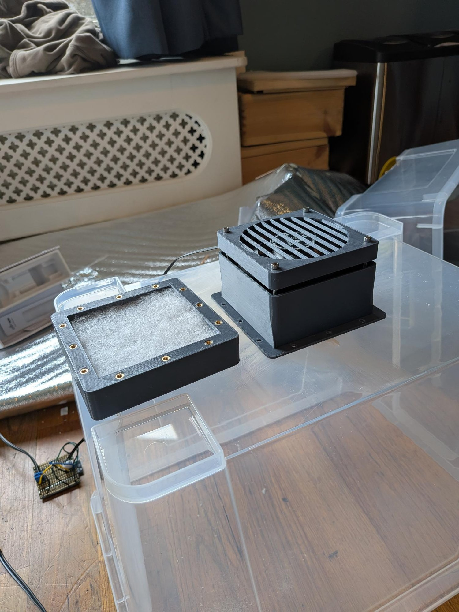
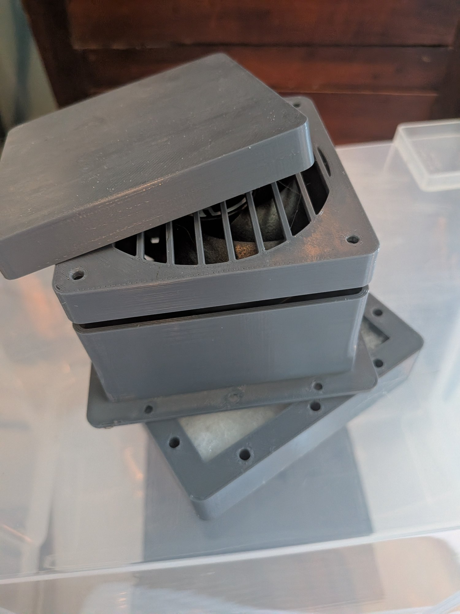
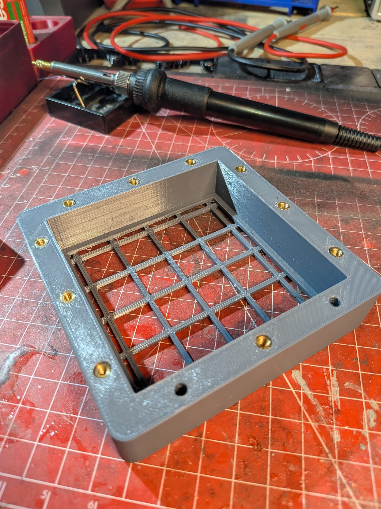
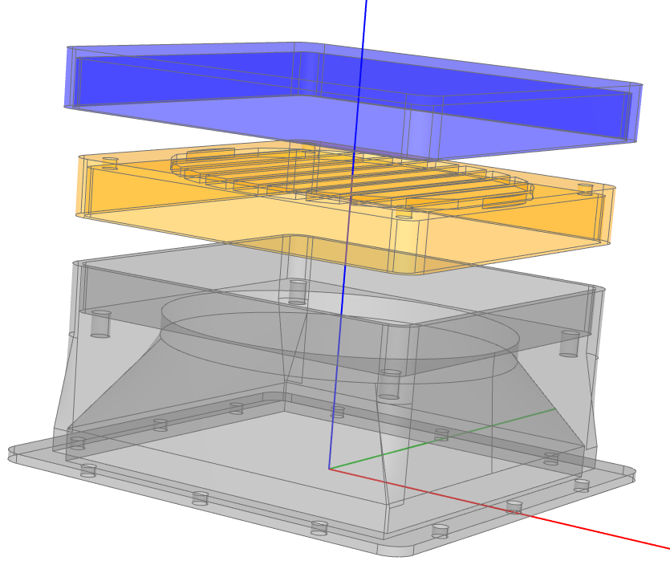
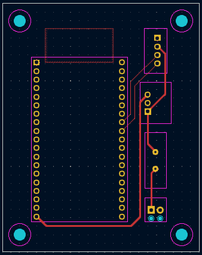
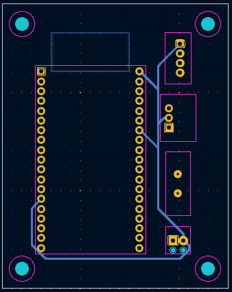

# clean-air-cabinet

A clean-air cabinet for airbrushed / freshly painted workpieces: an ESP32-driven
extraction fan pulling through a printed duct and foam filter, controlled from
Home Assistant.

One project, three disciplines:

| Folder | What | Tooling |
|---|---|---|
| `cad/` | Parametric fan duct, filter enclosure, finger-guard grill, dust cover, gaskets | build123d (uv), exported as STL/3MF |
| `pcb/` | Carrier board for the ESP32 fan controller — 12 V in, PTC polyfuse, Recom R-78B5.0 buck to 5 V | KiCad |
| `firmware/` | Fan on/off + PWM speed + tach RPM readback, native HA API | ESPHome |

See `docs/2026-08-22-cleanaircabinet-design.md` for the full electronics design
(wiring, GPIO assignment, assumptions) and `cad/` for the material rationale
(PETG over PETG-CF).

## Physical build status (2026-08-28)

Printed and assembled onto a repurposed storage bin; fan runs quietly at ~30–35 %.
Firmware MVP works (on/off + speed from HA, RPM readback). Environmental sensors
deferred — solvent vapour and paint aerosol degrade the candidate sensors.

## Photos

| | |
|---|---|
|  |  |
| Fan duct and filter enclosure mounted on the bin lid | Duct with finger-guard grill, dust cover and flange gaskets |
|  |  |
| Filter enclosure with brass heat-set inserts | Exploded build123d view: dust cover, grill, duct, flange |
|  |  |
| Carrier PCB, front copper | Carrier PCB, back copper |

## Firmware setup

```bash
cd firmware
just secrets                 # sops -d secrets.enc.yaml > secrets.yaml
esphome run cleanaircabinet.yaml   # first flash over USB, then OTA
```
